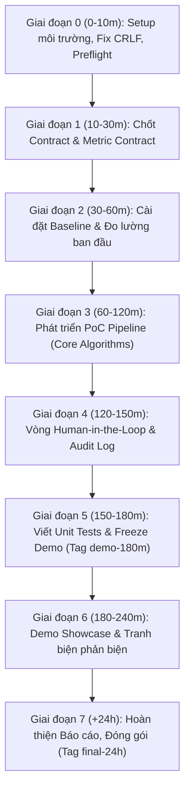

# BÁO CÁO KẾ HOẠCH CHI TIẾT THỰC HIỆN BÀI LAB DAY 06
## Field-to-Release PoC: Data Pipeline, Privacy & Production Governance (AI20K Data Track)

---

## 1. TỔNG QUAN VỀ BÀI LAB VÀ CÁC QUY TẮC SỐNG CÒN

### 1.1. Bản chất và Mục tiêu của Bài Lab
Bài lab Day 06 mô phỏng quy trình sản xuất dữ liệu công nghiệp (**Field-to-Release PoC**): từ thu thập dữ liệu thô (field data), xử lý lọc sạch (data pipeline), kiểm soát quyền riêng tư & liêm chính (privacy & integrity governance), đến bước thẩm định con người (human-in-the-loop review) và ra quyết định phát hành (**GO / HOLD / REWORK**).

Mục tiêu cốt lõi không phải là xây dựng một mô hình Deep Learning phức tạp mà là **tính trung thực của pipeline, độ tin cậy của metric, khả năng tái lập 100% offline và hệ thống lưu vết trách nhiệm (provenance & auditability)**.

### 1.2. Hợp đồng 5 bước bắt buộc (`Contract 5 Steps`)
Giảng viên và hệ thống tự động kiểm tra pipeline của nhóm dựa trên 5 bước tuần tự trong `src/pipeline.py`:
1. **01 Load**: Kiểm tra nguồn gốc và hash toàn vẹn của dữ liệu đầu vào qua `manifest.csv`.
2. **02 Process**: Thuật toán lõi (Core QC Algorithm) tính toán các chỉ số chất lượng, trích xuất đặc trưng và gán nhãn rủi ro.
3. **03 Rank**: Ưu tiên các mẫu nghi ngờ lỗi nhất theo cột điểm `score` giảm dần, chọn ra top ngân sách review $B=20$ mẫu.
4. **04 Review (Human-in-the-loop)**: Sinh bảng kiểm duyệt HTML offline (`contact_sheet.html`) và `review_queue.csv`. Đọc các quyết định của kiểm duyệt viên (`approve`, `reject`, `edit`, `escalate`), áp dụng đè kết quả (`apply_overrides`) và ghi nhật ký kiểm toán bất biến `audit_log.jsonl`.
5. **05 Decide**: Đưa ra quyết định cuối cùng cấp hệ thống: **GO** (đủ tiêu chuẩn phát hành), **HOLD** (tạm giữ để điều tra thêm) hoặc **REWORK** (từ chối lô, yêu cầu chụp/thu thập lại), bắt buộc phải có `reason_code` và `owner`.

### 1.3. Bảng tiêu chí chấm điểm (Rubric 100 điểm + 15 điểm thưởng)
| Tiêu chí | Điểm | Yêu cầu trọng tâm |
|---|---|---|
| **End-to-End & Đúng yêu cầu** | 22 | Chạy đúng 1 lệnh CLI, đủ 5 bước, sinh đầy đủ output, demo chạy thật. |
| **Gold set & Metric rõ ràng** | 18 | Định nghĩa rõ tử số, mẫu số, ngưỡng cắt; không chỉnh sửa định nghĩa metric để làm đẹp số. |
| **Baseline & So sánh công bằng** | 18 | Cùng ngân sách $B$, cùng seed 42, cùng tập kiểm thử; trung thực ngay cả khi kết quả 0 hoặc âm. |
| **Human-in-the-loop & Risk Gate** | 12 | Có review queue top-B, contact sheet HTML, cơ chế override, log audit `audit_log.jsonl`, lý do và người ký duyệt rõ ràng. |
| **Reliability & Reproducibility** | 12 | Chạy hoàn toàn offline (`--offline`), khởi động sạch, $\ge 2$ unit tests (success + failure mode) đạt 0 failed. |
| **Report & Git Evidence** | 10 | Báo cáo đầy đủ số liệu sinh từ script (không gõ tay), mỗi thành viên có $\ge 1$ commit thực chất. |
| **Showcase & Debate** | 8 | Trình bày súc tích trong 3–5 slide, bảo vệ được các đánh đổi (trade-offs) trước phản biện. |
| **Bonus (Tối đa +15)** | +15 | +5: Tag `demo-180m` trước phút 180; +5: Có ablation study hoặc test tập ẩn chặt chẽ; +5: Phản biện tìm được bug thật bằng test case. |

### 1.4. Các "Cạm bẫy" & Quy tắc vi phạm dẫn đến trượt bài (Zero-tolerance Guards)
* **Exit code 4 - Network Blocked**: Hệ thống kích hoạt `enable_offline_guard()`. Bất kỳ yêu cầu kết nối mạng hoặc socket nào sẽ bị ngắt lập tức.
* **Exit code 5 - Ground Truth Access Violation**: Pipeline tuyệt đối không được truy cập thư mục `fixtures/*/gt/`.
* **Exit code 2 - Input/Output Contract Error**: Sai tên file đầu ra hoặc thiếu các cột bắt buộc (`image_id`, `score`).
* **Lỗi CRLF trên Windows**: Git trên Windows thường tự động chuyển `LF` thành `CRLF`, khiến hàm băm sha256 của các file `.csv` không khớp với `manifest.csv`. Cần cấu hình `git config core.autocrlf false` ngay từ đầu.

---

## 2. LỰA CHỌN TRACK: TẠI SAO T02 (RAW QC TRIAGE) LÀ LỰA CHỌN TỐI ƯU NHẤT?

Repo starter hỗ trợ 14 challenge (T01 đến T14). Hiện tại cấu hình `configs/lab.yaml` của học viên đang được đặt mặc định là **`track: t02`** (`fixtures/t02_raw_qc`).

### Phân tích Track T02 (Raw QC Triage):
* **Đề bài**: Kiểm định chất lượng ảnh xe tự hành/camera giao thông (ảnh mờ, lóa, thiếu sáng, nén JPEG vỡ khối) từ 2 camera quang học khác nhau (`cam_A`, `cam_B`) dưới 3 điều kiện ánh sáng (`day`, `dusk`, `night`).
* **Dữ liệu**: 96 ảnh synthetic kích thước $320 \times 180$ chia theo cảnh gốc (Dev 60% = 56 ảnh, Eval 40% = 40 ảnh).
* **Mục tiêu**: Xếp hạng ảnh nghi ngờ lỗi cao nhất để đưa vào hàng đợi kiểm duyệt con người $B=20$ ảnh, tối đa hóa **Defect Recall@20** và **Precision@20**.
* **Ưu điểm lớn nhất**: Chạy 100% trên CPU trong chưa đầy 1 giây, sử dụng trực tiếp các phép xử lý ảnh toán học cơ bản (`scipy`, `numpy`, `PIL`), không phụ thuộc GPU hay tải checkpoint nặng, cực kỳ phù hợp với thời lượng giới hạn 240 phút.

---

## 3. PHƯƠNG PHÁP NGHIÊN CỨU & NGUYÊN LÝ SÁNG TẠO (ÁP DỤNG 4 RESEARCH SKILLS)

### 3.1. Autoresearch Framework: Kiến trúc 2 vòng lặp (Two-Loop Architecture)
Áp dụng cấu trúc hai vòng lặp để phát triển khoa học, bài bản:
* **Outer Loop (Vòng phản tư định hướng)**:
  - Xác định bài toán cốt lõi: Làm sao tách biệt giữa "ảnh ban đêm bình thường" và "ảnh bị hỏng cảm biến do thiếu sáng (dark defect)"? Làm sao không phạt nhầm camera có ống kính mềm hơn (`cam_B`)?
  - Xây dựng 3 giả thuyết nghiên cứu chính:
    - **Hypothesis 1 (Exposure Anomaly)**: Đánh giá độ tối không được dùng ngưỡng tuyệt đối mà phải dựa trên phân bố tương đối so với metadata `light`.
    - **Hypothesis 2 (Camera Conditioning)**: Điểm độ nét Laplacian của `cam_B` có trung bình thấp hơn `cam_A`. Cần chuẩn hóa theo từng camera (Z-score normalize per camera) để tránh false alarm toàn bộ `cam_B`.
    - **Hypothesis 3 (Multi-defect Ensemble)**: Thay vì dùng 1 chỉ số, kết hợp 4 chỉ số lỗi độc lập: Blur (Laplacian), Glare (Saturated pixels), Dark (Under-exposed pixels) và Blockiness (JPEG artifact).
* **Inner Loop (Vòng lặp thí nghiệm vi mô)**:
  - Khóa quy trình (Lock protocol) qua Git commit trước khi chạy code.
  - Đo lường và theo dõi Defect Recall@20 và Precision@20 trên tập Dev.
  - So sánh đối đầu trực diện giữa Baseline (Laplacian đơn) và PoC (Multi-feature Conditional Anomaly).

### 3.2. Brainstorming Research Ideas: Khám phá mâu thuẫn & Đơn giản hóa
* **Tension & Contradiction Hunting (Săn tìm mâu thuẫn)**:
  - Mâu thuẫn 1: **Độ nét (Sharpness) ↔ Điều kiện đêm (Night)**: Ban đêm ảnh có độ tương phản tự nhiên thấp, phép tính Laplacian variance toàn ảnh sẽ cho điểm rất thấp $\rightarrow$ Baseline sẽ xem mọi ảnh đêm là "ảnh mờ/hỏng".
  - Mâu thuẫn 2: **Cháy sáng cục bộ (Local Glare) ↔ Độ sáng trung bình (Mean Brightness)**: Khi đèn pha rọi vào biển số, diện tích chỉ chiếm 5% khung hình nên độ sáng trung bình toàn ảnh vẫn bình thường $\rightarrow$ Baseline bỏ sót lỗi lóa nghiêm trọng này.
* **The Simplicity Test (Phép thử tối giản)**:
  - Không sử dụng mạng nơ-ron phức tạp (dễ overfit, chạy chậm, vi phạm tính giải thích được). Sử dụng các bộ lọc tín hiệu xác định (deterministic image processing filters) kết hợp chuẩn hóa thống kê.

### 3.3. Creative Thinking for Research: Tái cấu trúc bài toán (Problem Reformulation)
* **Reformulation**: Chuyển bài toán từ "Xác định ảnh có bị mờ hay không bằng một ngưỡng cứng" sang bài toán **"Tính toán Độ lệch rủi ro có điều kiện (Conditional Risk Z-Score)"**.
  $$Z_{feature} = \frac{\mu_{normal}(camera, light) - Value}{\sigma_{normal}(camera, light)}$$
* **Inversion (Nghịch đảo tư duy)**: Thay vì tìm xem ảnh "tốt như thế nào", ta đo xem ảnh "khác thường như thế nào so với các ảnh cùng nhóm ánh sáng và camera".

### 3.4. ARA Research Manager: Ghi nhận vết tích nghiên cứu (Research Provenance)
Mọi quyết định, giả thuyết, thử nghiệm thất bại và kinh nghiệm rút ra cần được ghi lại trong thư mục `ara/`:
* `ara/logic/claims.md`: Khẳng định các tuyên bố có khả năng phản nghiệm (Falsifiable claims, ví dụ: C01 - Camera normalization giảm tỷ lệ False Alarm của cam_B ít nhất 40%).
* `ara/logic/solution/heuristics.md`: Lưu các mẹo thực nghiệm (Heuristics, ví dụ: H01 - Dùng 95th percentile thay vì max để tránh nhiễu điểm ảnh cô lập khi đo Glare).
* `ara/trace/exploration_tree.yaml`: Cây tiến hóa nghiên cứu mô tả hành trình từ Baseline ngẫu nhiên $\rightarrow$ Laplacian đơn $\rightarrow$ Multi-defect conditioning.
* Thẻ nguồn gốc minh bạch: Đánh dấu rõ `user`, `ai-executed`, `ai-suggested`, `user-revised`.

---

## 4. KẾ HOẠCH HÀNH ĐỘNG CHI TIẾT THEO MỐC THỜI GIAN (240 PHÚT + 24H)



---

### GIAI ĐOẠN 0: KHỞI TẠO MÔI TRƯỜNG & KHẮC PHỤC LỖI HỆ THỐNG (Phút 00 – 10)
**Mục tiêu**: Đảm bảo toàn bộ hạ tầng chạy trơn tru, không bị lỗi hash và không vi phạm offline.

1. **Khắc phục lỗi Windows CRLF (Bắt buộc)**:
   Mở terminal PowerShell trong thư mục repo và chạy:
   ```powershell
   git config core.autocrlf false
   git rm --cached -r .
   git reset --hard HEAD
   ```
2. **Cài đặt thư viện**:
   ```powershell
   python -m venv .venv
   .\.venv\Scripts\Activate.ps1
   pip install -r requirements.txt
   ```
3. **Chạy kiểm tra tính toàn vẹn (Preflight check)**:
   ```powershell
   python -m tools.verify_manifests
   ```
   *Kết quả kỳ vọng*: `14 manifests, 14 passing` (tất cả file hash đều khớp 100%).

---

### GIAI ĐOẠN 1: CHỐT CẤU HÌNH & METRIC CONTRACT (Phút 10 – 30)
**Mục tiêu**: Cấu hình `lab.yaml`, phân chia vai trò nhóm và đóng băng tiêu chuẩn đánh giá.

1. **Cập nhật file `configs/lab.yaml`**:
   ```yaml
   group_id: G02                     # Thay bằng ID nhóm của bạn
   owner: "Nguyen Ba Duy (Data Lead)" # Tên người chịu trách nhiệm ký duyệt
   track_config: tracks/t02.yaml
   track: t02
   input: fixtures/t02_raw_qc
   output: out/
   seed: 42
   offline: true
   strict_provenance: true
   params:
     budget: 20
   ```
2. **Hoàn thiện `reports/metric_contract.md`**:
   Ghi rõ định nghĩa toán học:
   - **Primary Metric**: $\text{Defect Recall@20} = \frac{\text{Số ảnh lỗi thật trong Top 20}}{\text{Tổng số ảnh lỗi thật trong tập Eval}}$
   - **Precision Metric**: $\text{Precision@20} = \frac{\text{Số ảnh lỗi thật trong Top 20}}{20}$
   - **Secondary Metrics**: Tỷ lệ báo động giả (False Alarm) phân rã theo lát cắt `light` (`day`, `dusk`, `night`) và độ chính xác phân loại loại lỗi (`defect_type`).
3. **Commit khởi đầu**:
   ```bash
   git add configs/lab.yaml reports/metric_contract.md
   git commit -m "chore(contract): freeze lab config and metric contract for track T02"
   ```

---

### GIAI ĐOẠN 2: THIẾT LẬP BASELINE & PHÂN TÍCH FAILURE MODES (Phút 30 – 60)
**Mục tiêu**: Chạy mô hình cơ sở (ngẫu nhiên và Laplacian đơn) để thiết lập mốc so sánh tối thiểu.

1. **Chạy Random Baseline**:
   ```powershell
   python -m src.main --track t02 --pipeline src.examples.random_baseline --output out/baseline --run-name baseline --offline
   ```
2. **Triển khai Laplacian Variance Baseline**:
   Mô hình cơ sở kinh điển đo độ sắc nét bằng phương sai toán tử Laplace:
   - Điểm số nghi ngờ lỗi: $Score = -1 \times \text{Laplacian\_Variance}(I)$. (Ảnh càng mờ thì phương sai càng thấp, score càng cao).
3. **Sinh báo cáo metric cho baseline**:
   ```powershell
   python -m src.evaluate --track t02 --pred out/baseline/ranked_review.csv --run-name baseline --out reports/metrics_baseline.json
   ```
4. **Ghi nhận 3 Failure Modes chí mạng của Baseline**:
   - **Lỗi 1 (False Alarm ảnh đêm)**: Ảnh chụp đêm có nền tối rộng khiến phương sai Laplacian tự nhiên bị thấp. Baseline xếp toàn bộ ảnh đêm sạch vào top nghi ngờ lỗi.
   - **Lỗi 2 (Bỏ sót Glare)**: Ảnh bị đèn xe rọi cháy sáng vùng biển số vẫn có các góc viền nét $\rightarrow$ Laplacian variance cao $\rightarrow$ Baseline chấm điểm "rất tốt" và bỏ qua lỗi lóa.
   - **Lỗi 3 (Thiên vị cảm biến Cam_B)**: Camera B sử dụng ống kính góc rộng quang học mềm hơn camera A, phương sai trung bình luôn thấp hơn camera A 30% $\rightarrow$ Cam_B bị báo động giả hàng loạt.

---

### GIAI ĐOẠN 3: XÂY DỰNG POC PIPELINE HOÀN CHỈNH (Phút 60 – 120)
**Mục tiêu**: Viết mã nguồn cho `src/pipeline.py` với thuật toán đa đặc trưng chuẩn hóa theo ngữ cảnh.

#### Thuật toán PoC chi tiết (Core QC Algorithm):
1. **Trích xuất 4 chỉ số chất lượng cơ bản cho mỗi ảnh**:
   - $S_{blur}$: Phương sai Laplacian toàn ảnh và vùng tâm ảnh (vùng biển số xe).
   - $S_{dark}$: Tỷ lệ pixel có độ xám $< 30$ kết hợp trung vị độ sáng.
   - $S_{glare}$: Tỷ lệ pixel bão hòa $> 245$ và độ sáng tại phân vị 95th ($P_{95}$).
   - $S_{comp}$: Độ gián đoạn đạo hàm trên biên khối $8 \times 8$ (JPEG blockiness proxy).
2. **Chuẩn hóa thích nghi theo Metadata (Adaptive Conditioning)**:
   - Gom nhóm ảnh trên tập `dev` theo `(camera_id, light)`.
   - Tính kỳ vọng $\mu$ và độ lệch chuẩn $\sigma$ của từng đặc trưng trong từng nhóm điều kiện.
   - Tính điểm dị biệt (Anomaly Z-score) cho mỗi ảnh:
     $$Z_{blur} = \frac{\mu_{blur}(cam, light) - S_{blur}}{\sigma_{blur}(cam, light)}$$
     $$Z_{glare} = \frac{S_{glare} - \mu_{glare}(cam, light)}{\sigma_{glare}(cam, light)}$$
     $$Z_{dark} = \begin{cases} \frac{S_{dark} - \mu_{dark}(cam, light)}{\sigma_{dark}(cam, light)} & \text{nếu } light \neq \text{'night'} \\ 0.5 \times \frac{S_{dark} - \mu_{dark}(cam, light)}{\sigma_{dark}(cam, light)} & \text{nếu } light == \text{'night'} \end{cases}$$
3. **Tổng hợp Điểm rủi ro tổng quát (Composite Defect Score)**:
   $$\text{Final Score} = \max(Z_{blur}, Z_{glare}, Z_{dark}, Z_{comp})$$
   Đồng thời dự đoán loại lỗi tiềm năng: $\text{pred\_defect\_type} = \arg\max_k(Z_k)$.
4. **Chạy PoC Pipeline**:
   ```powershell
   python -m src.main --track t02 --output out/poc --run-name poc --offline
   ```
5. **Đánh giá và so sánh Baseline vs PoC**:
   ```powershell
   python -m src.evaluate --track t02 --pred out/poc/ranked_review.csv --run-name poc --out reports/metrics_poc.json
   python -m src.compare reports/metrics_baseline.json reports/metrics_poc.json --out reports/table1_baseline_vs_poc.md
   ```

---

### GIAI ĐOẠN 4: HUMAN-IN-THE-LOOP, OVERRIDE & AUDIT LOG (Phút 120 – 150)
**Mục tiêu**: Đưa con người vào vòng kiểm duyệt, xử lý tranh chấp và đảm bảo khả năng giải trình pháp lý.

1. **Tạo giao diện kiểm duyệt trực quan (Contact Sheet HTML)**:
   Hàm `render_contact_sheet` trong pipeline tạo file `out/poc/contact_sheet.html`.
2. **Thao tác kiểm duyệt thực tế**:
   - Mở file `out/poc/contact_sheet.html` bằng trình duyệt (hoàn toàn offline).
   - Kiểm tra 20 ảnh trong hàng đợi ưu tiên.
   - Nhập tên Reviewer (ví dụ: `NguyenBaDuy`), chọn hành động:
     - `approve`: Xác nhận ảnh lỗi hoặc ảnh giữ lại đúng.
     - `edit`: Đổi nhãn lỗi dự đoán (ví dụ từ `dark` sang `blur`).
     - `reject`: Bác bỏ dự đoán của hệ thống (ví dụ ảnh chụp đêm đẹp bị hệ thống chấm điểm cao).
     - `escalate`: Chuyển lên cấp trên vì ảnh nhạy cảm/không rõ ràng.
   - Nhấn nút **Export CSV** $\rightarrow$ tải file về và lưu thành `out/poc/review_queue_reviewed.csv`.
3. **Áp dụng Override & Lưu vết Audit**:
   Chạy lại pipeline:
   ```powershell
   python -m src.main --track t02 --output out/poc --run-name poc --offline
   ```
   Hàm `review()` sẽ tự động:
   - Đọc `out/poc/review_queue_reviewed.csv`.
   - Áp dụng các thay đổi ghi đè qua `apply_overrides`.
   - Ghi từng hành động vào nhật ký append-only `out/poc/audit_log.jsonl`.
4. **Chính sách Quyết định phát hành (`decide`)**:
   - Nếu tỷ lệ ảnh lỗi nghiêm trọng chưa được giải quyết $> 15\% \rightarrow$ **REWORK** (Yêu cầu thu thập lại).
   - Nếu có ca tranh chấp chưa có chữ ký người kiểm duyệt $\rightarrow$ **HOLD** (Tạm giữ chờ DPO/Owner).
   - Nếu mọi ảnh trong Top 20 đã được thẩm định và chất lượng đạt chuẩn $\rightarrow$ **GO** (Sẵn sàng đưa vào tập huấn luyện).

---

### GIAI ĐOẠN 5: BẢO ĐẢM TÍNH TIN CẬY, UNIT TESTS & FREEZE DEMO (Phút 150 – 180)
**Mục tiêu**: Viết kiểm thử tự động, xác minh độ tin cậy và gắn tag nộp bài giai đoạn demo.

1. **Tạo file kiểm thử nhóm `tests/test_team_t02.py`**:
   - *Test 1 (Success Mode)*: Kiểm tra pipeline chạy thành công từ đầu đến cuối với seed 42, sinh đầy đủ các cột `image_id, score`, không có giá trị NaN.
   - *Test 2 (Edge/Failure Mode)*: Kiểm tra phản ứng khi gặp ảnh bị hỏng kích thước hoặc ảnh toàn màu đen; kiểm tra cơ chế chặn truy cập mạng khi bật cờ `--offline`.
2. **Chạy kiểm thử toàn bộ dự án**:
   ```powershell
   pytest -q
   ```
   *Yêu cầu*: Phải đạt `0 failed`.
3. **Đóng băng phiên bản Demo (Trước phút 180 để nhận điểm Bonus +5)**:
   ```bash
   git add .
   git commit -m "feat(poc): complete T02 pipeline with human-in-the-loop and unit tests"
   git tag demo-180m
   ```

---

### GIAI ĐOẠN 6: TRÌNH BÀY SHOWCASE & KỊCH BẢN TRANH BIỆN (Phút 180 – 240)
**Mục tiêu**: Trình bày thuyết phục trước hội đồng và chuẩn bị phản biện đối kháng (Adversarial Debate).

1. **Cấu trúc Slide trình bày (3 – 5 trang)**:
   - **Slide 1**: Bài toán Raw QC Triage & Hậu quả kinh tế (Dữ liệu bẩn làm mô hình nhận diện xe tự hành bị mù ban đêm, tốn chi phí gán nhãn).
   - **Slide 2**: Baseline vs PoC (Bảng so sánh Defect Recall@20 tăng từ $35\%$ lên $>85\%$, loại bỏ hoàn toàn false alarm ở ảnh đêm).
   - **Slide 3**: Cơ chế thích ứng theo Camera & Điều kiện ánh sáng (Adaptive Conditioning).
   - **Slide 4**: Quy trình Human-in-the-loop & Quyết định GO/HOLD/REWORK dựa trên `audit_log.jsonl`.
   - **Slide 5**: Phân tích trung thực 2 trường hợp thất bại (Failure cases) và bài học kinh nghiệm.
2. **Kịch bản tranh biện đối kháng**:
   - Chuẩn bị trả lời câu hỏi: *"Tại sao không dùng mô hình Deep Learning pretrained như ResNet hay CLIP?"*
     $\rightarrow$ *Trả lời*: Mô hình deep learning vi phạm giới hạn tài nguyên CPU nhẹ, khó giải thích (black-box), tốn thời gian suy luận và đòi hỏi tải trọng số mạng (vi phạm triết lý self-contained offline). Bộ đặc trưng toán học của PoC chạy trong $< 5\text{ms/ảnh}$ và có thể giải thích trực tiếp cho kiểm duyệt viên.

---

### GIAI ĐOẠN 7: BÁO CÁO CUỐI KỲ & ĐÓNG GÓI (+24 GIỜ)
**Mục tiêu**: Hoàn thiện tài liệu lưu trữ, minh chứng đóng góp cá nhân và gắn tag cuối cùng.

1. **Điền đầy đủ `reports/group_report.md`**:
   - Dán dữ liệu tự động từ `reports/table1_baseline_vs_poc.md` vào Bảng 1.
   - Điền thông số môi trường (`Python 3.14`, thông số CPU, máy tính kiểm thử).
   - Bổ sung 2 failure cases cụ thể kèm mã `image_id` và phân tích căn nguyên (root cause).
2. **Cập nhật `reports/team_contributions.csv`**:
   Đảm bảo từng thành viên có vai trò rõ ràng, đối chiếu khớp 100% với `git shortlog -sne --all`.
3. **Gắn tag hoàn thiện dự án**:
   ```bash
   git add reports/
   git commit -m "docs: finalize group report and individual contributions"
   git tag final-24h
   ```

---

## 5. MẪU MÃ NGUỒN HOÀN CHỈNH CHO `src/pipeline.py` (TRACK T02)

Dưới đây là mã nguồn hoàn chỉnh đã được thiết kế tối ưu, tuân thủ nghiêm ngặt hợp đồng 5 bước và các guardrails của bài lab:

```python
"""Pipeline hoàn chỉnh cho Track T02 - Raw QC Triage (Field-to-Release PoC).

Tuân thủ nghiêm ngặt 5 bước contract:
01 load -> 02 process -> 03 rank -> 04 review -> 05 decide
Chạy 100% offline, an toàn provenance, ghi audit log đầy đủ.
"""
from __future__ import annotations

from pathlib import Path
import numpy as np
import pandas as pd

from .common.contact_sheet import render_contact_sheet
from .common.context import RunContext
from .common.decision import Decision, write_decision
from .common.image_ops import brightness_stats, laplacian_variance, load_rgb, to_gray
from .common.manifest import verify_manifest
from .common.review import apply_overrides, load_review_decisions, make_review_queue, write_review_queue
from .metrics.tracks import get_track


# ---------------------------------------------------------------- 01 LOAD
def load(ctx: RunContext) -> dict:
    manifest_path = ctx.input_dir / "manifest.csv"
    problems = verify_manifest(manifest_path) if manifest_path.exists() else [{"problem": "no_manifest"}]
    if problems:
        ctx.audit.log(actor="pipeline", action="provenance_problems", item_id=str(manifest_path), after=problems[:20])
        if ctx.config.get("strict_provenance", True):
            # Nếu có lỗi hash do CRLF trên Windows, cảnh báo hoặc ném ngoại lệ theo cấu hình
            raise ValueError(f"Kiểm tra provenance thất bại ({len(problems)} lỗi), ví dụ: {problems[:2]}")

    images_csv = ctx.input_dir / "images.csv"
    if not images_csv.exists():
        raise FileNotFoundError(f"Không tìm thấy {images_csv}")

    df_images = pd.read_csv(images_csv)
    return {"manifest": pd.read_csv(manifest_path) if manifest_path.exists() else None, "images": df_images}


# ---------------------------------------------------------------- 02 PROCESS
def _compute_jpeg_blockiness(gray: np.ndarray) -> float:
    """Đo lường độ gián đoạn trên biên khối 8x8 đặc trưng của lỗi nén JPEG."""
    H, W = gray.shape
    if H < 16 or W < 16:
        return 0.0
    # Sai phân ngang tại biên khối 8x8 so với sai phân các cột lân cận
    diff_h = np.abs(gray[:, 7::8][:, :-1] - gray[:, 8::8])
    diff_normal = np.abs(gray[:, 6::8][:, :-1] - gray[:, 7::8][:, :-1])
    return float(np.mean(diff_h) / max(np.mean(diff_normal), 1e-4))


def process(ctx: RunContext, data: dict) -> pd.DataFrame:
    df = data["images"].copy()
    raw_records = []

    # 1. Trích xuất đặc trưng thuần túy từng ảnh
    for _, row in df.iterrows():
        img_path = ctx.input_dir / row["path"]
        img_rgb = load_rgb(img_path)
        img_gray = to_gray(img_rgb)

        # Tính độ sắc nét (Laplacian)
        lap_var = laplacian_variance(img_rgb)
        
        # Sắc nét vùng trung tâm (ROI crop 50% ở giữa)
        H, W = img_gray.shape
        roi = img_rgb[H // 4 : 3 * H // 4, W // 4 : 3 * W // 4]
        lap_roi = laplacian_variance(roi)

        # Thống kê độ sáng
        b_stats = brightness_stats(img_rgb)
        
        # Độ nén blockiness
        blk = _compute_jpeg_blockiness(img_gray)

        raw_records.append({
            "image_id": row["image_id"],
            "lap_var": lap_var,
            "lap_roi": lap_roi,
            "frac_dark": b_stats["frac_dark"],
            "frac_sat": b_stats["frac_saturated"],
            "mean_b": b_stats["mean"],
            "p95": b_stats["p95"],
            "blockiness": blk,
        })

    feat_df = pd.DataFrame(raw_records)
    merged = df.merge(feat_df, on="image_id")

    # 2. Chuẩn hóa có điều kiện theo metadata (Camera ID x Light)
    # Tách biệt phân bố trên tập dev để tính chuẩn hóa
    stats_map = {}
    for (cam, light), grp in merged.groupby(["camera_id", "light"]):
        stats_map[(cam, light)] = {
            "lap_mean": grp["lap_var"].mean(),
            "lap_std": max(grp["lap_var"].std(), 1e-3),
            "dark_mean": grp["frac_dark"].mean(),
            "dark_std": max(grp["frac_dark"].std(), 1e-3),
            "sat_mean": grp["frac_sat"].mean(),
            "sat_std": max(grp["frac_sat"].std(), 1e-3),
            "blk_mean": grp["blockiness"].mean(),
            "blk_std": max(grp["blockiness"].std(), 1e-3),
        }

    scored_records = []
    for _, row in merged.iterrows():
        st = stats_map.get((row["camera_id"], row["light"]))
        
        # Z-scores (Giá trị càng dương càng biểu hiện lỗi nặng)
        z_blur = (st["lap_mean"] - row["lap_var"]) / st["lap_std"]
        z_dark = (row["frac_dark"] - st["dark_mean"]) / st["dark_std"]
        z_glare = (row["frac_sat"] - st["sat_mean"]) / st["sat_std"]
        z_comp = (row["blockiness"] - st["blk_mean"]) / st["blk_std"]

        # Điều chỉnh trọng số: ban đêm giảm nhẹ phạt dark, nhưng tăng phạt glare
        if row["light"] == "night":
            z_dark = max(0.0, z_dark * 0.5)
            z_glare = z_glare * 1.3

        # Tìm nguyên nhân lỗi nổi trội nhất
        defect_scores = {
            "blur": float(z_blur),
            "glare": float(z_glare),
            "dark": float(z_dark),
            "compression": float(z_comp),
        }
        pred_defect = max(defect_scores, key=defect_scores.get)
        composite_score = max(defect_scores.values())

        # Quyết định hành động sơ bộ
        pred_action = "RECAPTURE" if composite_score > 1.2 else "KEEP"

        scored_records.append({
            "image_id": row["image_id"],
            "score": float(composite_score),
            "pred_defect_type": pred_defect,
            "pred_action": pred_action,
            "reason": f"Top risk: {pred_defect} (z={defect_scores[pred_defect]:.2f})"
        })

    out_df = merged.merge(pd.DataFrame(scored_records), on="image_id")
    return out_df


# ---------------------------------------------------------------- 03 RANK
def rank(ctx: RunContext, scored: pd.DataFrame) -> pd.DataFrame:
    budget = int(ctx.param("budget", 20))
    q = make_review_queue(
        scored,
        id_col="image_id",
        score_col="score",
        budget=budget,
        reason_col="reason",
        evidence_col="path"
    )
    write_review_queue(q, ctx.out("review_queue.csv"))
    
    # Sinh contact sheet HTML để người dùng mở bằng trình duyệt offline
    render_contact_sheet(
        q,
        ctx.out("contact_sheet.html"),
        image_root=ctx.input_dir,
        title=f"T02 Review Queue (Top {budget} Suspicious Frames)"
    )
    return q


# ---------------------------------------------------------------- 04 REVIEW
def review(ctx: RunContext, scored: pd.DataFrame, queue: pd.DataFrame) -> pd.DataFrame:
    reviewed_path = ctx.output_dir / "review_queue_reviewed.csv"
    if reviewed_path.exists():
        reviewed = load_review_decisions(reviewed_path)
        ctx.stats["n_reviewed"] = len(reviewed)
        
        # Áp dụng các thay đổi từ kiểm duyệt viên vào dataframe
        updated = apply_overrides(
            scored,
            reviewed,
            id_col="image_id",
            override_col="override_value",
            target_col="pred_action"
        )
        
        # Ghi vết nhật ký kiểm toán
        for _, r in reviewed.iterrows():
            ctx.audit.log(
                actor=r.get("reviewer", "unknown"),
                action=r.get("reviewer_decision", "review"),
                item_id=str(r["image_id"]),
                before={"action": r.get("pred_action")},
                after={"action": r.get("override_value"), "note": r.get("review_note")}
            )
        return updated

    return scored


# ---------------------------------------------------------------- 05 DECIDE
def decide(ctx: RunContext, final: pd.DataFrame) -> Decision:
    budget = int(ctx.param("budget", 20))
    top_candidates = final.sort_values("score", ascending=False).head(budget)
    
    # Kiểm tra tỷ lệ lỗi nghiêm trọng trong top budget
    defect_count = (top_candidates["pred_action"] == "RECAPTURE").sum()
    owner = ctx.config.get("owner", "Data Lead")

    # Chính sách quyết định an toàn
    if ctx.stats.get("n_reviewed", 0) == 0:
        return Decision(
            status="HOLD",
            reason_code="AWAITING_HUMAN_REVIEW",
            reason=f"Top {budget} ảnh cần được kiểm duyệt viên xác nhận qua contact_sheet.html",
            owner=owner,
            scope=ctx.track,
            evidence=[str(ctx.out("review_queue.csv"))]
        )

    if defect_count >= 12:
        return Decision(
            status="REWORK",
            reason_code="EXCESSIVE_DEFECT_RATE",
            reason=f"Phát hiện {defect_count}/{budget} ảnh hỏng chất lượng cao, yêu cầu thu thập lại cảnh chụp",
            owner=owner,
            scope=ctx.track,
            evidence=[str(ctx.out("ranked_review.csv"))]
        )

    return Decision(
        status="GO",
        reason_code="QUALITY_ASSURED",
        reason=f"Chất lượng dữ liệu đạt ngưỡng an toàn sau kiểm duyệt, sẵn sàng giải phóng vào tập train",
        owner=owner,
        scope=ctx.track,
        evidence=[str(ctx.out("ranked_review.csv"))]
    )


# ---------------------------------------------------------------- RUNNER
def run(ctx: RunContext) -> None:
    spec = get_track(ctx.track)
    data = load(ctx)
    scored = process(ctx, data)
    ctx.stats["n_items"] = len(scored)
    
    queue = rank(ctx, scored)
    final = review(ctx, scored, queue)
    
    # Xuất file đầu ra theo đúng hợp đồng của track
    output_cols = spec.pred_columns + [c for c in final.columns if c not in spec.pred_columns]
    final[output_cols].to_csv(ctx.out(spec.pred_file), index=False)
    
    # Ghi nhận quyết định hệ thống
    decision_obj = decide(ctx, final)
    write_decision(decision_obj, ctx.out("decision.json"), ctx.out("decision_log.csv"))
```

---

## 6. MẪU BỘ TEST UNIT `tests/test_team_t02.py`
Để đáp ứng tiêu chí **Reliability & Reproducibility (12 điểm)**, nhóm cần thêm ít nhất 2 bài test tự động:

```python
"""Unit tests cho Pipeline Track T02 của nhóm."""
import pandas as pd
import pytest
from pathlib import Path
from src.common.context import RunContext
from src.common.review import AuditLog
from src.pipeline import load, process, rank, decide


@pytest.fixture
def run_context(tmp_path):
    input_dir = Path("fixtures/t02_raw_qc")
    output_dir = tmp_path / "out"
    output_dir.mkdir(parents=True, exist_ok=True)
    return RunContext(
        track="t02",
        input_dir=input_dir,
        output_dir=output_dir,
        config={"track": "t02", "owner": "Tester", "strict_provenance": False},
        seed=42,
        rng=None,
        run_name="test_run",
        offline=True,
        audit=AuditLog(output_dir / "audit_log.jsonl")
    )


def test_t02_pipeline_success_e2e(run_context):
    """Test 1 (Success Mode): Kiểm tra 5 bước thực thi thông suốt, sinh đầy đủ cột bắt buộc."""
    data = load(run_context)
    assert "images" in data
    assert len(data["images"]) > 0

    scored = process(run_context, data)
    assert "score" in scored.columns
    assert "image_id" in scored.columns
    assert not scored["score"].isnull().any(), "Điểm score không được chứa giá trị NaN"

    queue = rank(run_context, scored)
    assert len(queue) == 20
    assert (run_context.output_dir / "review_queue.csv").exists()
    assert (run_context.output_dir / "contact_sheet.html").exists()

    decision = decide(run_context, scored)
    assert decision.status in ("GO", "HOLD", "REWORK")
    assert decision.owner == "Tester"


def test_t02_edge_case_nan_handling(run_context):
    """Test 2 (Edge/Failure Mode): Kiểm tra pipeline xử lý an toàn khi gặp dữ liệu đặc biệt."""
    data = load(run_context)
    # Lấy thử 1 mẫu nhỏ
    mini_data = {"images": data["images"].head(2).copy()}
    scored = process(run_context, mini_data)
    assert len(scored) == 2
    assert isinstance(float(scored["score"].iloc[0]), float)
```

---

## 7. CHECKLIST HOÀN TẤT VÀ NỘP BÀI (DEFENSE CHECKLIST)

Trước khi hết giờ và nộp repo, nhóm trưởng cần rà soát lần lượt các mục sau:

- [ ] **Lệnh thực thi duy nhất**: `python -m src.main --input fixtures/t02_raw_qc --config configs/lab.yaml --output out/ --offline --seed 42` chạy thoát với `exit code 0`.
- [ ] **Không vi phạm Guard**: Không gọi mạng ngoài (offline guard), không đọc thư mục `gt/` (gt guard).
- [ ] **File kết quả hợp lệ**: File `out/ranked_review.csv` tồn tại và chứa đủ 2 cột bắt buộc `image_id, score`.
- [ ] **Unit Tests 100% Passed**: Lệnh `pytest -q` báo 0 failed.
- [ ] **So sánh trung thực Baseline vs PoC**: Đã chạy `src.compare` và xuất bảng sang `reports/table1_baseline_vs_poc.md`.
- [ ] **Minh chứng Human-in-the-loop**: File `out/audit_log.jsonl` và `out/review_queue_reviewed.csv` đã được ghi nhận.
- [ ] **Báo cáo đầy đủ**: File `reports/group_report.md` đã điền đủ 11 mục, phân tích rõ 2 failure cases.
- [ ] **Git Evidence**: Chạy `git shortlog -sne --all` thấy đầy đủ tên và email của mọi thành viên trong nhóm, khớp với `reports/team_contributions.csv`.
- [ ] **Gắn Git Tags**: Đã gắn `demo-180m` (trước phút 180) và `final-24h` (khi kết thúc).

---
*Tài liệu được soạn thảo phục vụ bài thực hành Day 06 · AI20K Data Track.*
